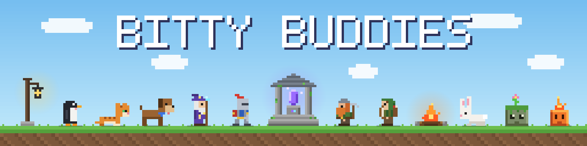

# Bitty Buddies

> **© 2026 WiggleCodes. All rights reserved.**
> This code is public for viewing only. It may not be copied, modified, claimed as your own, or re-uploaded anywhere without written permission. See [LICENSE](LICENSE).

Blocky pixel pets that wander along the bottom of your screen, plus little builds they like to nap beside. For Windows, and it keeps itself up to date.

**[Download Bitty Buddies](https://github.com/WiggleCodes/bitty-buddies/releases/latest)** · **[Website](https://wigglecodes.github.io/bitty-buddies/)**

## What they get up to

Everything lives in the tray / menu-bar icon (the little dog):

- **Spawn** a buddy from Critters or Fantasy Folk
- **Build** a Shrine, Campfire or Lantern Post, plus a Burrow Cottage, Wizard's Tower, Dwarf Forge and Treehouse with Fantasy Folk
- **Play**: start a battle, throw a ball, drop some treats, throw a dance party or start a conga line
- **Mischief** mode lets them get up to things on their own: chasing your cursor, climbing the edges of your screen and picking little scraps with each other

On your desktop:

- **Click** a buddy to make it jump, or **drag** it to pick it up and throw it
- **Hover** over one for a moment to give it a pat
- **Right-click** to make it sit, nap, go for a walk, chase the mouse, climb the wall or start a battle
- Buddies that catch your cursor ride along on it until you shake them off
- Grab the ball and throw it yourself, or drag builds around to make a little camp

Clicks pass straight through to your desktop everywhere except the buddies themselves, and everything you place is remembered for next time.

Fantasy Folk and its builds unlock with a licence key from WiggleCodes.

## Licence

© 2026 WiggleCodes. All rights reserved. You may view the code and use official releases for personal use. You may not copy, modify, claim as your own, or re-upload this code or its artwork anywhere. Full terms in [LICENSE](LICENSE).
